<p align="center">
  
</p>

<p align="center">
  <strong>Production-validated LLM inference benchmarks for Intel Arc GPUs (Battlemage B60).</strong><br>
  Real measured throughput (tok/s), proven quantization recipes, and MoE-vs-dense data — not synthetic marketing numbers.
</p>

<p align="center">
  <a href="LICENSE"></a>
  
  
  
</p>

> 🔧 **Want to run these models yourself?** The companion repo **[intel-arc-llm-stack](https://github.com/dirtysouthalpha/intel-arc-llm-stack)** is the full one-command server (IPEX-LLM SYCL + Vulkan llama.cpp + model hot-swap + OpenAI-compatible gateway) these benchmarks are measured on.

## Our Setup

- **GPU**: Intel Arc Pro B60 21GB (Vulkan1)
- **Host**: Ubuntu 26.04 LTS, 7.0.0-30-generic kernel
- **Driver**: xe driver (Xe architecture)
- **Backend**: llama.cpp Vulkan
- **Production Model**: Huihui-Qwen3-Coder-30B-A3B-Instruct-abliterated IQ4_XS @ ~40 tok/s

## Why This Exists

Most LLM benchmarks are NVIDIA-focused. Intel Arc owners get vague "it works" claims but no real-world data.

We run **production LLM workloads** on an Arc B60 24/7. We have:
- Real speed measurements (not synthetic benchmarks)
- Proven quantization recipes
- Actual production traffic patterns
- Autonomous testing infrastructure

## Current Findings (2026-09-01)

### Models Tested

| Model | Size | Quant | Speed (warm) | Status |
|-------|------|-------|--------------|--------|
| Huihui-Qwen3-Coder-30B-A3B-Instruct-abliterated | 30B | IQ4_XS | ~40 tok/s | ✅ PRODUCTION |
| Huihui-Qwen3.8-27B-abliterated | 27B | IQ4_XS | 4.4 tok/s | ❌ REJECTED |

### Key Insights

1. **MoE > Dense**: 30B MoE outperforms 27B dense by 9x on B60 Vulkan
2. **Speed floor**: 20 tok/s is our hard minimum for production
3. **A3B quantization**: IQ4_XS hits the sweet spot of speed + quality
4. **No co-loading**: Never load two models on B60 simultaneously - driver spills to RAM

### Known Bottlenecks

- **Speculative decoding**: Not available on Intel Vulkan backend
- **Low-bit tensor kernels**: Missing compared to NVIDIA's CUDA implementations
- **Attention optimization**: Basic implementation, no Flash Attention equivalent

## Repository Structure

```
intel-arc-llm-benchmarks/
├── README.md           # This file
├── docs/
│   ├── setup.md        # How to set up benchmark environment
│   ├── methodology.md  # Testing methodology and metrics
│   └── findings/       # Detailed benchmark results by model
├── scripts/
│   ├── benchmark.sh    # Main benchmark runner
│   ├── speed-test.sh   # Speed test script
│   └── cleanup.sh      # Post-test cleanup
├── configs/
│   └── launch-templates/  # Proven llama-server launch configs
└── results/
    └── latest/         # Most recent benchmark results
```

## Quick Start

```bash
# Clone and setup
git clone https://github.com/dirtysouthalpha/intel-arc-llm-benchmarks.git
cd intel-arc-llm-benchmarks

# Run a speed test
./scripts/speed-test.sh --model <path-to-gguf> --quant IQ4_XS

# View results
cat results/latest/speed-test.json
```

## Contributing

We welcome contributions, especially:
- Model benchmarks (please follow our methodology)
- Driver optimization patches
- Quantization experiments
- Production deployment guides

## License

MIT License - See LICENSE file

## Contact

- **Maintainer**: [@dirtysouthalpha](https://github.com/dirtysouthalpha)
- **Hardware**: Intel Arc Pro B60 (Battlemage), Ubuntu 26.04
- **Production**: 24/7 local LLM inference
- Questions, corrections, or your own numbers? [Open an issue](https://github.com/dirtysouthalpha/intel-arc-llm-benchmarks/issues).

---

**Our mission**: Make Intel Arc a first-class citizen for LLM inference through transparent, production-validated benchmarks.

---

## Support this project

Built and maintained by one person, in the open. If it saves you time or
money, you can throw something in the hat — entirely optional, and it changes
nothing about the license or what ships.

<a href="https://cash.app/$vladien"></a>

**Cash App — [$vladien](https://cash.app/$vladien)**

Scan the code, or follow the link.

No tiers, no paywalled features, no "pro" build.

<br clear="left">

---
### More from Dirty South Alpha
*Self-hosted AI. Security-first. Always innovating.*

- 🚀 [intel-arc-llm-stack](https://github.com/dirtysouthalpha/intel-arc-llm-stack) — run any LLM locally on Intel Arc
- 🎛️ [muse-maestro](https://github.com/dirtysouthalpha/muse-maestro) — guardrails, memory & cost telemetry for Meta Muse Code
- 🤖 [sentinel-code](https://github.com/dirtysouthalpha/sentinel-code) — multi-provider AI coding agent with smart model routing
- 🛠️ [msp-tier3-toolkit](https://github.com/dirtysouthalpha/msp-tier3-toolkit) — battle-tested MSP PowerShell
- 👤 [@dirtysouthalpha](https://github.com/dirtysouthalpha) — the full fleet

⭐ If this saved you time, star it and follow for more.

---
<p align="center"><sub><b>Dirty South Alpha™</b> · © 2026 · <a href="https://dirtysouthalpha.com">dirtysouthalpha.com</a> · self-hosted AI · security-first</sub></p>
